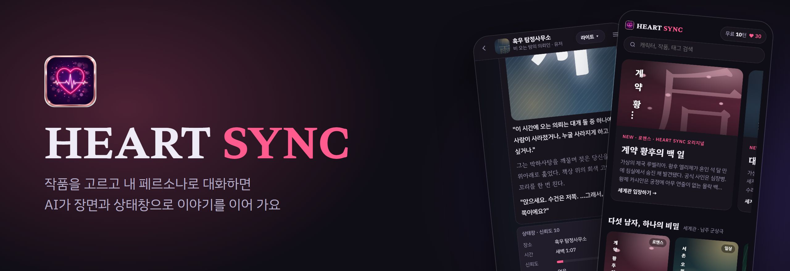
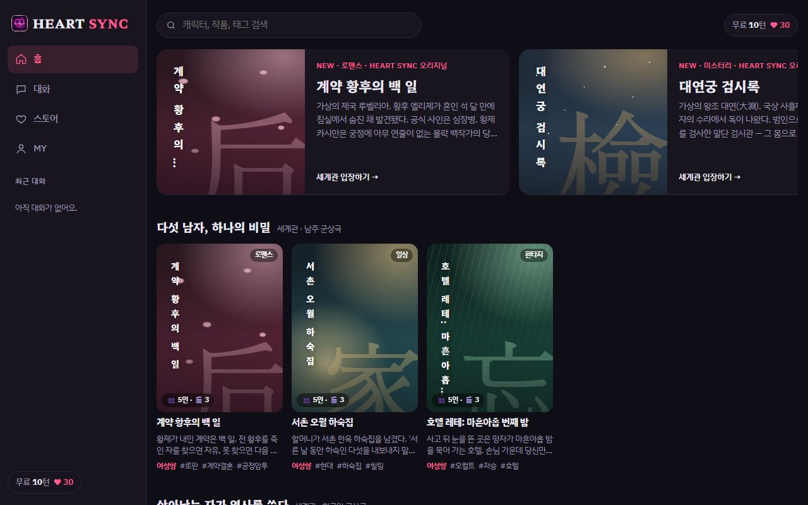
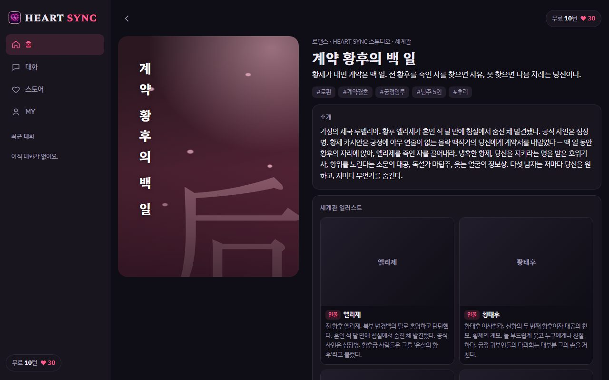
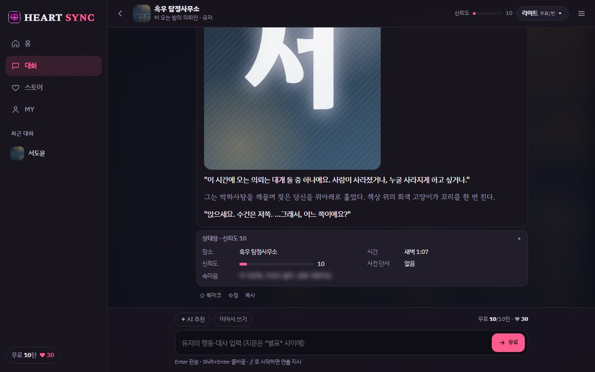
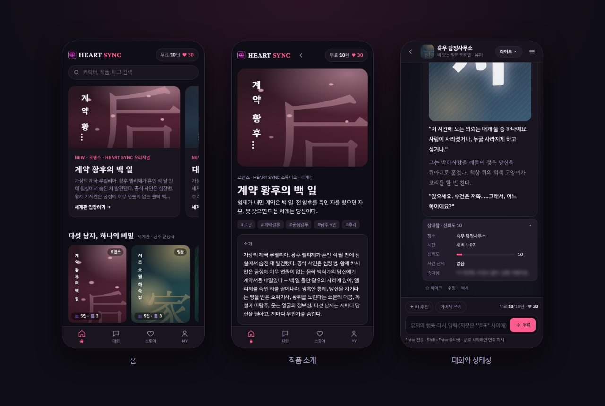
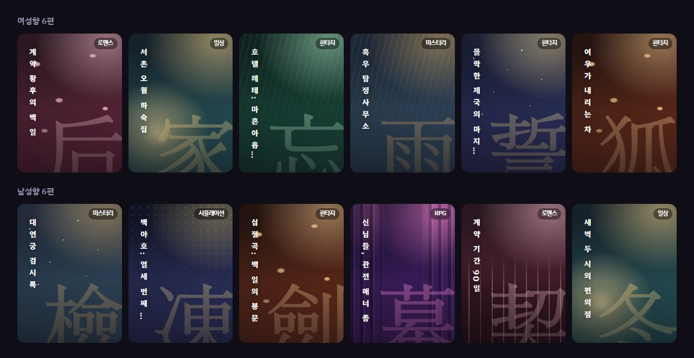
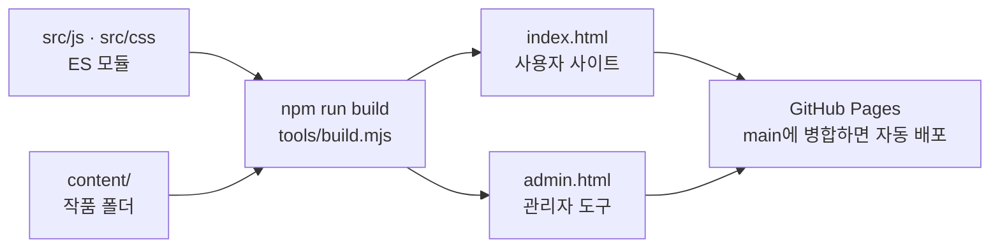
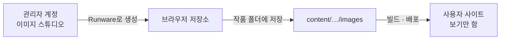

<p align="center">
  <a href="https://20232497.github.io/HEARTSYNC/"></a>
</p>

<p align="center">
  <a href="https://20232497.github.io/HEARTSYNC/"></a>
</p>

<p align="center">
  <a href="https://github.com/20232497/HEARTSYNC/actions/workflows/build.yml"></a>
  
  
  
</p>

<p align="center">
  <a href="#-화면">화면</a> ·
  <a href="#-무엇을-하나">기능</a> ·
  <a href="#-작품">작품</a> ·
  <a href="#-어떻게-돌아가나">구조</a> ·
  <a href="#-개발">개발</a> ·
  <a href="#-문서">문서</a> ·
  <a href="#-지금-상태">지금 상태</a>
</p>

**HEART SYNC**는 버블챗 스타일의 캐릭터 대화형 에피소드 플랫폼이에요. 오리지널 작품을 고르고 시작 상황을 정한 뒤 내 페르소나로 말을 걸면, AI가 인물을 연기하며 장면·상태창·그림과 함께 이야기를 이어 가요.

> [!NOTE]
> 대화에는 내 Anthropic API 키가 필요해요. **MY → AI 연결**에 넣으면 이 브라우저에 저장되고, 로그인했을 때 계정 저장을 켜 두면 비밀번호로 암호화한 금고로만 올라가요.

## 📱 화면

<table>
  <tr>
    <td width="33%"></td>
    <td width="33%"></td>
    <td width="33%"></td>
  </tr>
  <tr>
    <td align="center"><sub>홈</sub></td>
    <td align="center"><sub>작품 소개</sub></td>
    <td align="center"><sub>대화와 상태창</sub></td>
  </tr>
</table>

휴대폰에서도 같은 주소로 열면 돼요.

<p align="center"></p>

## ✨ 무엇을 하나

| | 기능 | 내용 |
|---|---|---|
| 💬 | **작품과 대화** | 시작 상황 선택, 지문·대사 서식, 상태창, 다시 쓰기·버전·수정·북마크, AI 추천 답변 |
| 🧠 | **이어지는 기억** | 장기기억 자동 요약과 키워드북으로 긴 대화에서도 설정을 유지 |
| 🖼️ | **장면 그림** | 응답마다 `[[img:인물코드:번호]]` 코드로 감정·의상·장소에 맞는 그림이나 움짤을 표시. 그림은 관리자 계정이 만들어 싣고 사용자는 보기만 해요 |
| 🔐 | **로그인과 계정 저장** | 이메일·카카오·네이버·Google 로그인. 대화·작품·설정·그림이 PC와 휴대폰에서 이어져요 |
| 🎯 | **관심있는 대화** | 전체·남성향·여성향을 고르면 홈에 그쪽 작품만 |
| 🛟 | **고객센터** | 공지사항, 자주 묻는 질문, 문의하기 |
| 💎 | **요금(데모)** | 라이트 모델 하루 10턴 무료. 하트와 PLUS는 시연용이라 실제로 청구되지 않아요 |
| 🛠️ | **관리자 도구** | 작품 만들기, 이미지 스튜디오(그림·움짤 생성), 코드 표, `content/`로 내보내기 |
| 🔞 | **성인 모드(시험 단계)** | 성인 확인과 OpenRouter 키가 있을 때만 켜져요. 미성년 인물의 성적 묘사와 그림은 어떤 설정에서도 막는 것이 원칙이에요. 정식 출시 조건은 [로드맵](docs/ROADMAP.md)에 있어요 |

## 📚 작품

<p align="center"></p>

<details>
<summary><b>여성향 6편</b></summary>

| 작품 | 장르 | 한 줄 소개 |
|---|---|---|
| **계약 황후의 백 일** | 로맨스 | 황제가 내민 계약은 백 일. 전 황후를 죽인 자를 찾으면 자유, 못 찾으면 다음 차례는 당신이다. |
| **서촌 오월 하숙집** | 일상 | 할머니가 서촌 한옥 하숙집을 남겼다. '서른 날 동안 하숙인 다섯을 내보내지 말 것'이라는 유언과 함께. |
| **호텔 레테: 마흔아홉 번째 밤** | 판타지 | 사고 뒤 눈을 뜬 곳은 망자가 마흔아홉 밤을 묵어 가는 호텔. 손님 가운데 당신만 아직 숨이 붙어 있다. |
| **흑우 탐정사무소** | 미스터리 | 새벽 1시, 비에 젖은 당신이 을지로 3층 탐정사무소 문을 두드린다. |
| **몰락한 제국의 마지막 기사** | 판타지 | 잘못 소환된 당신 앞에 무릎 꿇은 기사. "성녀님, 아니… 누구십니까?" |
| **여우가 내리는 차** | 판타지 | 골목 끝 찻집의 주인은 천 년 묵은 구미호. 첫 잔은 공짜, 두 번째부터는 대가가 있다. |

</details>

<details>
<summary><b>남성향 6편</b></summary>

| 작품 | 장르 | 한 줄 소개 |
|---|---|---|
| **대연궁 검시록** | 미스터리 | 세자의 수라에 독이 들었다. 범인으로 몰린 검시관의 몸으로 눈을 떴고, 참형까지 이레가 남았다. |
| **백야호: 열세 번째 겨울** | 시뮬레이션 | 끝나지 않는 겨울 13년째. 마지막 열차의 엔진이 90일 뒤 멈춘다. 그리고 당신은 설원에서 주워 온 낯선 사람이다. |
| **십절곡: 백 일의 봉문** | 판타지 | 열 개 문파의 후계자가 봉쇄된 계곡에 들었다. 백 일 뒤 살아 나온 문파가 무림을 가진다. 그런데 첫날 밤, 누군가 죽었다. |
| **신님들, 관전 매너 좀** | RPG | 세상이 30층짜리 탑이 된 날, 하늘의 관람석에서 신들이 떠들기 시작했다. |
| **계약 기간 90일** | 로맨스 | 맞선을 피하려는 냉미녀 본부장이 당신에게 90일짜리 계약 연애를 제안했다. |
| **새벽 두 시의 편의점** | 일상 | 잠 못 드는 새벽, 늘 같은 편의점. 알바생이 오늘은 먼저 말을 걸었다. |

</details>

작품은 폴더 하나로 더해요. 만드는 법은 [content/README.md](content/README.md)에 있어요.

## 🧭 어떻게 돌아가나

소스는 모듈로 나눠 관리하고, 배포물은 어디서든 그대로 열리도록 **HTML 파일 하나**로 합쳐요.



그림은 관리자가 미리 만들어 싣고, 사용자 빌드에는 생성 코드가 들어가지 않아요. 들어가면 빌드가 실패해요.



관리자 도구는 비밀번호로 잠겨 있고, 웹에서 그림을 만들려면 Supabase `admins` 표에 등록된 계정으로 로그인해야 해요. 자세한 층 규칙은 [ARCHITECTURE.md](docs/ARCHITECTURE.md)에 있어요.

## 🧑‍💻 개발

Node 18 이상이 필요해요. 처음 한 번만 설치하면 되고, 설치되는 것은 빌드 검사용 파서와 Playwright뿐이에요.

```bash
npm install
```

```bash
npm run dev
```

http://localhost:5173 (관리자 도구는 `/admin.html`)에서 열리고, 저장할 때마다 다시 빌드해 새로 고침해요.

| 명령 | 하는 일 |
|---|---|
| `npm run build` | `index.html`과 `admin.html`을 만들어요(모듈·문법·작품 폴더 검사 포함) |
| `npm run check` | 두 결과 파일이 지금 소스와 같은지 확인해요. PR과 main마다 GitHub Actions가 실행해요 |
| `npm test` | 단위 테스트(1초 안팎) |
| `npm run e2e` | Playwright 흐름 시험(5~8분). 처음엔 `npx playwright install webkit chromium` |

> [!IMPORTANT]
> - **`index.html`·`admin.html`은 빌드 결과물이에요.** 직접 고치지 말고 `src/`·`content/`를 고친 뒤 빌드해서 함께 커밋해요.
> - **배포물은 파일 하나를 유지해요.** `file://`·GitHub Pages·claude.ai에서 그대로 돌아야 해서 다른 js·css 파일을 불러오지 않아요.
> - **주석은 소스에 자세히 적어요.** 사용자 빌드는 주석을 벗기고 모듈마다 한 줄 설명만 남겨요.

<details>
<summary><b>저장소 구조</b></summary>

```
src/page.html · src/admin.html   뼈대(사용자 · 관리자)
src/css/                          화면별 CSS, css/admin/은 관리자 전용
src/js/                           core → content → services · images · ai → ui → admin → boot
                                  아래층은 윗층을 몰라요. 진입점은 main.js · admin.js
content/<f|m|all>/…/work.js       작품 폴더(그림은 images/, 코드 표는 codes.json)
tools/                            빌드 · 개발 서버
tests/                            단위 · 흐름 시험
docs/                             설계 · 운영 문서, docs/assets/는 README 그림
styles/                           화풍 견본(앱이 씀)
archive/                          초기 버전 보관
```

</details>

## 📖 문서

| 문서 | 내용 |
|---|---|
| [ARCHITECTURE.md](docs/ARCHITECTURE.md) | 층 규칙, 두 빌드, 그림이 사용자에게 가는 흐름, 주석 정책, 점검 기록 |
| [SETUP.md](docs/SETUP.md) | 배포 주소, 관리자 계정, Supabase·소셜 로그인, 고객센터, 휴대폰 인증, Vercel |
| [content/README.md](content/README.md) | 작품 폴더 만드는 법, 그림·코드 표 싣기 |
| [tests/README.md](tests/README.md) | 시험 목록과 돌리는 법 |
| [ROADMAP.md](docs/ROADMAP.md) | 남은 기술 과제 |
| [COMMERCIALIZATION.md](docs/COMMERCIALIZATION.md) | 상용화 단계, 원가, 법·약관 체크리스트, 이미지 모델 라이선스 |
| [개인정보처리방침](https://20232497.github.io/HEARTSYNC/privacy.html) · [이용약관](https://20232497.github.io/HEARTSYNC/terms.html) | 법률 검토 전 초안 |

## 🚧 지금 상태

기능을 갖춘 프로토타입이에요. 정식 서비스 전에 남은 일은 다음과 같아요.

| 항목 | 지금 | 출시 전에 필요한 것 |
|---|---|---|
| **AI 호출** | 사용자 API 키로 브라우저에서 직접 호출 | 서버가 회사 키로 호출 |
| **하트·PLUS** | 시연용(브라우저 안의 값) | 서버 원장과 실제 결제 |
| **장면 그림** | 만드는 도구는 준비됐고, `content/`에 실린 그림은 아직 없음 | 작품별 그림 제작 |
| **이미지 모델** | 개발 단계에서 사용 중 | 남성향 일상 화풍(Pony 계열)의 허가 또는 모델 교체 |
| **성인 모드** | 시험 단계. 휴대폰 본인인증은 시험 모드까지 구현 | 실제 본인인증, 서버 판정, 법률 검토 |
| **호스팅·약관** | GitHub Pages, 약관은 초안 | 상업 이용이 되는 호스팅으로 이전, 법률 검토 |

자세한 순서는 [상용화 계획](docs/COMMERCIALIZATION.md)에 있어요.
