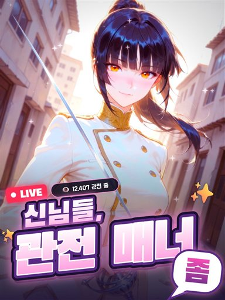
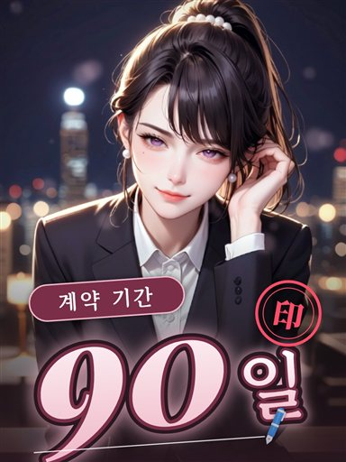
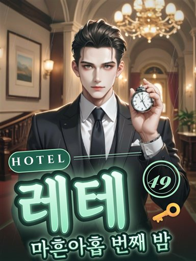
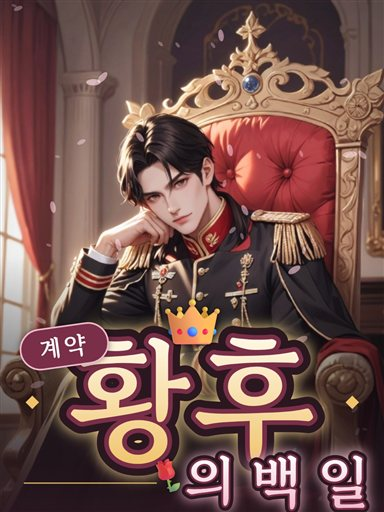
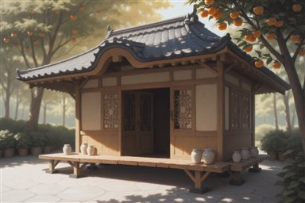

# 작품 그림 규칙 — 화풍 나누기 · 장소 · 표지 · 로고

인물 화풍 셋([남성향 애니](../style-manime/) · [남성향 일상](../style-mdaily/) · [여성향 일상](../style-fdaily/)) 위에 얹는 **작품 단위** 규칙입니다. 어느 작품이 어느 화풍인지, 장소 그림과 표지를 어떻게 그리는지, 표지에 제목 로고를 어떻게 얹는지를 정합니다.

2026-11-14 사용자와 비교 생성으로 정했습니다(장소·표지 시험 약 270장). 그림은 관리자만 만들고, 앱은 이 폴더를 쓰지 않습니다.

| 견본 | |
|---|---|
| 표지(로고까지) |     |
| 장소 |    |

## 1. 화풍 나누기

| 작품 | 화풍 |
|---|---|
| 신님들, 관전 매너 좀(`godseats`) | 남성향 애니(Nova Orange) |
| 그 밖의 모든 작품 | 일상(여성 인물은 남성향 일상 · 남성 인물은 여성향 일상) |

사용자 결정은 '**일단은** 신님들만 애니로'입니다. 두 화풍으로 같은 인물을 그려 비교한 뒤 정했고, 바뀔 수 있어 `code/place.js`의 `ANIME_WORKS` 한 곳에 둡니다.

## 2. 장소 그림

사람 없는 풍경 한 장입니다. 두 화풍 모두 **Nova Orange**로 그립니다 — 일상 화풍의 모델(Pony 계열)은 풍경과 구도를 잘 따르지 않습니다. 마감 문구와 후처리만 화풍에 맞춥니다.

| 값 | |
|---|---|
| 모델 | Nova Orange XL v6.0(`civitai:967405@1428332`) · Euler a · 28단계 · CFG 4 |
| 크기 | 1152×768로 그리고 1728×1152로 키워 다시 그림(0.4). Runware는 64의 배수만 받아 예전 규격 1248×832는 만들 수 없음 |
| 구도 | 정면에서 넓게(`no humans, scenery, wide shot`) — 한눈에 알아보기 쉽고 대화 배경으로도 무난(사용자) |
| 애니 마감 | 인물 그림과 같은 채색 문구 + 남성향 애니 후처리 |
| 일상 마감 | 낮은 대비·밝은 노출·부드러운 초점·차분한 색(밤 장소는 등불 빛) + 일상 후처리. 두 값을 그려 비교해 고름 |
| 시드 | 9100 + 장소 번호 |

규칙:

- **사람 낱말은 뺀다.** 장소 태그의 `martial artists`·`spectators`·`hooded figures`·`lone knight`·`army` 같은 낱말은 장소 그림에서 빼고, 사람 네거티브를 넣는다.
- **밤 장소는 밤으로.** 태그에 night·dusk·moonlight 등이 있으면 밤 문구를 넣고 낮을 막는다.
- **작품 색조.** 작품의 `artTags`가 색 두 가지로 끝나면(`teal and amber` · `deep blue and gold` …) 그 작품의 모든 장소에 약하게 넣는다.
- **일본풍은 기본으로 막는다.** 모델 버릇으로 동양풍 장소에 도리이·후지산·한자 간판이 끼어든다(십절곡 비무대, 을지로 골목에서 확인).
- **전통 한국 건물**(`hanok`·`joseon`·`traditional korean`·`gisaeng`·`bukchon`)은 한옥 묘사(기와·창호·서까래)를 더하고 다다미·쇼지 방을 더 세게 막는다.

확인한 것: 14개 작품에서 16곳을 그려 사람이 한 명도 섞이지 않았고, 사용자가 마감과 구도를 확정했습니다. 나머지 장소는 관리 페이지에서 그려 고릅니다.

## 3. 표지

**여러 명을 그리지 않습니다.** 작품마다 대표 인물 한 명, 구도와 자세는 작품마다 다르게 잡습니다(사용자 — 여러 명을 한 장에 그리면 얼굴과 옷이 섞이고, 따로 그려 합치면 뚝뚝 끊겨 보여 전면 폐지).

- **대표 인물**은 그 작품에서 가장 예쁘거나 그림이 가장 자연스럽거나 개성 있는 인물입니다(첫 인물이 대표로 애매한 작품이 있음). `code/cover.js`의 `LEADS`에 적습니다.
- **두 단계로 그린다(일상).** 일상 화풍은 구도 문구를 잘 따르지 않아, Nova Orange가 구도를 잡은 밑그림을 일상 화풍이 다시 그립니다(0.75). 애니는 감정 그림 작업에서 구도 자리만 바꿔 바로 그립니다.
- **구도**(`SHOT`): 가까이(가슴 위)는 손짓 하나로 작품을 드러내고, 멀리는 장면이 곧 작품인 경우만(황제의 왕좌·기사의 맹세).
- 쓰지 않는 자세: 돌아보는 자세(뒤태가 도드라짐) · 팔짱(가슴이 도드라짐) · 목에 손(눈을 감고 조는 모습) · 갑옷 차림으로 가슴에 손(건틀릿이 갈고리처럼 나옴).

| 작품 | 대표 | 구도 |
|---|---|---|
| godseats | 한서윤 `HSY` | 레이피어를 화면 앞으로 |
| hangyeoul | 한겨울 `HGU` | 계산대에 턱 괴기 |
| yunhaera | 윤해라 `YHR` | 머리카락 넘기기 |
| sipjeol | 남궁설 `NGS` | 검 손잡이에 손 |
| daeyeon | 이화 `IHW` | 위에서 내려다본 얼굴 |
| minwon | 홍 여사 `HME` | 쉿 |
| baekya | 서하진 `SHJ` | 고글 고쳐 쓰기 |
| hwanghu | 카시안 `KAS` | 왕좌(멀리) |
| kael | 카엘 `KAEL` | 검을 짚고 무릎(멀리) |
| lethe | 차사현 `CSH` | 회중시계 |
| seodoyun | 서도윤 `SDY` | 머그잔 |
| hasuk | 강태하 `KTH` | 밥그릇 |
| baekyeon | 백연 `BY` | 찻잔 |
| geumseo | 아델 `ADL` | 책 |

**남자**(사용자: 부자연스럽고 느끼함 → 네 방식을 그려 비교해 '얼굴선 부드럽게', 그 뒤 '너무 무뚝뚝함' → 은은한 미소):

- 표정은 입을 다문 은은한 미소. 비웃는 입·반쯤 감은 눈·장난스러운 눈빛 문구는 쓰지 않고 네거티브로 막는다.
- 화풍 문구의 날카로운 턱·좁은 눈·근육 가중치를 낮춘다(성인 표시는 그대로).
- 가까이 잡은 표지는 키우지 않는다(키우면 선이 딱딱해짐). 멀리 잡은 표지만 0.3으로 키워 얼굴을 살린다.

**여자**(사용자: 조금 더 가녀리게 → 한 단계 더):

- 본 그림에서 가녀린 몸 문구를 올리고 큰 가슴·넓은 어깨를 막는다.
- 밑그림에는 어깨·팔·허리 문구를 넣지 않는다 — 넣으면 어깨가 드러난 옷이 나온다. 긴소매를 명시하고 드러난 어깨·트임을 세게 막는다.

**후처리**: 화풍 후처리 → 표지 후처리(`code/cover-post.js` — 색·대비 조금, 밝은 곳 번짐, 작품 색을 위에서 아래로, 작품 무늬의 입자, 가장자리 어둡게) → 로고. 네 단계를 보고 사용자가 '빛 번짐과 입자까지'를 골랐습니다.

## 4. 로고

표지 아래쪽에 제목 로고를 얹습니다(`code/logo.js`가 그리고 `code/logos.js`가 작품별 설계). 여섯 차례 다듬었습니다.

- **틀은 두 갈래**(사용자: '신님들'과 '계약 기간 90일' 정도의 이모티콘 활용·글씨체 느낌): 굵은 고딕을 기울인 생방송 느낌 · 우아한 바탕체에 알약 딱지와 둥근 도장.
- 그 안에서 작품마다 글자 색·기울기·배치를 다르게 하고 **그 작품만의 장치를 하나씩** 둡니다(편의점 간판 줄무늬, 꺼져 가는 민원실 글자, 기사의 검 밑줄, 대연궁의 세로 딱지 …).
- 큰 간판·명판·부적으로 아래를 덮는 설계는 버렸습니다.
- 제목에 없는 **덧글**(LIVE · 번호표 444번 손님 · 방 있음 · 의뢰 접수 중 …)은 분위기를 살리는 초안입니다(사용자 '지금처럼 넣기'). 작품의 글은 세계관 세션이 주인이라 바뀔 수 있습니다.
- 글꼴은 Google Fonts(Black Han Sans · Do Hyeon · Gowun Batang · Noto Serif KR · Cinzel · Orbitron · Playfair Display — 모두 OFL)입니다.

## 파일

| 파일 | |
|---|---|
| `code/place.js` | 화풍 나누기(`styleOf`)와 장소 작업(`placeJob`) |
| `code/cover.js` | 대표·구도 표(`LEADS`·`SHOT`)와 표지 작업(`coverJob`) |
| `code/cover-post.js` | 표지 후처리(브라우저 캔버스) |
| `code/logo.js` · `code/logos.js` | 로고 그리기(브라우저 캔버스)와 작품별 설계 |
| `code/jobs.mjs` | 모든 작품의 표지·장소 작업을 뽑고 검사 |
| `samples/` | 이 규칙으로 만든 견본(384px) |

```bash
node archive/style-works/code/jobs.mjs check
```

모든 작품의 표지와 장소 작업을 만들어 사람 없음·성인 표시·미성년과 노출 네거티브·문구 길이(Runware는 3000자까지)를 확인합니다. 작품 id를 주면 그 작품의 작업을 JSON으로 출력합니다.

## 지킬 것

1. **모든 인물은 성인입니다.** 성인 표시와 child·loli·shota·underage·toddler·aged down·nsfw·nude 네거티브를 빼지 않습니다. 만든 그림은 눈으로 확인합니다 — 어려 보이거나 노출이 있는 그림은 쓰지 않습니다.
2. 노출이 도드라지는 옷과 자세(가슴골·비치는 옷·드러난 어깨·뒤태 강조)를 쓰지 않습니다.
3. 참고 그림은 공개 저장소에 커밋하지 않습니다. 견본은 우리가 만든 384px 그림만 씁니다.
4. 생성 서비스의 키는 저장소·채팅에 적지 않습니다.

## 남은 과제

- **한옥 실내**: 마루의 창호가 일본식 쇼지와 닮게 나옵니다(다다미는 사라짐). 한옥을 따로 배운 보조 모델이 필요할 수 있습니다.
- **간판 글자**: 네온 간판·현수막에 뜻 없는 글자가 그려집니다.
- **이모티콘 글꼴**: 로고의 이모티콘은 그림을 만드는 PC의 글꼴로 그려집니다(Windows는 Segoe UI Emoji). PC가 바뀌면 모양이 달라지므로, 공개 전에 Noto Color Emoji(OFL)로 고정할지 정합니다.
- **홍 여사의 머리**: 사용자가 '촘촘한 일자 앞머리·반묶음'으로 정했습니다. 지금은 표지에서만 태그를 바꿔 그립니다(`LEADS.minwon.tags`) — 세계관 세션이 인물 태그를 고치면 그 칸을 지웁니다.
- **새 작품**: `LEADS`와 `logos.js`에 한 줄씩 더합니다. 없으면 첫 인물·기본 구도로 그려지고 로고 없이 나옵니다.
- 표지 견본 가운데 백연·아델·남궁설은 비교 시험 때의 시드로 그린 것이라, 다시 그리면 규칙은 같아도 그림은 조금 다릅니다.
