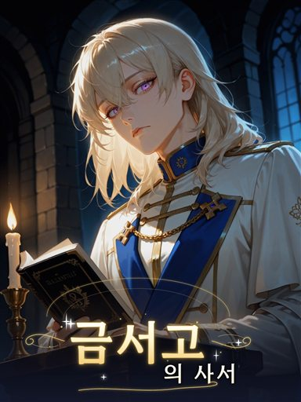
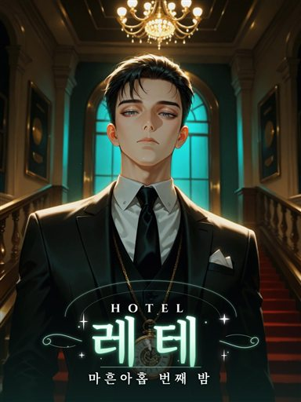
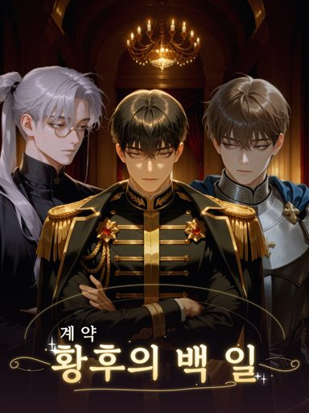
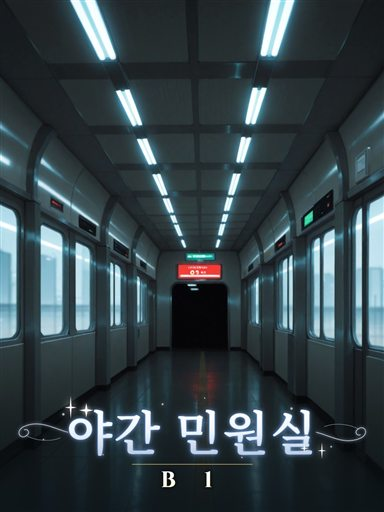
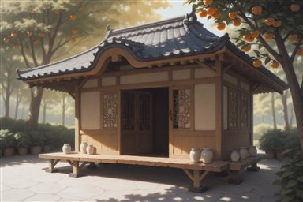
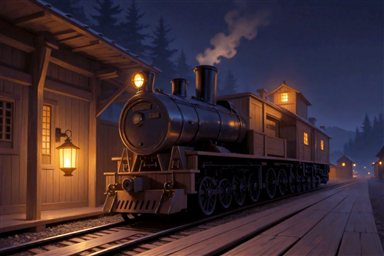

# 작품 그림 규칙 — 화풍 나누기 · 장소 · 표지 · 로고

인물 화풍 셋([남성향 애니](../style-manime/) · [남성향 일상](../style-mdaily/) · [여성향 일상](../style-fdaily/)) 위에 얹는 **작품 단위** 규칙입니다. 어느 작품이 어느 화풍인지, 장소 그림과 표지를 어떻게 그리는지, 표지에 제목 로고를 어떻게 얹는지를 정합니다.

2026-11-14 사용자와 비교 생성으로 정했고(장소·표지 시험 약 270장), **표지와 로고는 2026-11-16~20에 다시 정했습니다**(3·4장). 그림은 관리자만 만들고, 앱은 이 폴더를 쓰지 않습니다.

| 견본 | |
|---|---|
| 표지(로고까지 — 가까이 · 한 명 + 배경 · 단체 · 상징물) |     |
| 장소 |    |

## 1. 화풍 나누기

| 작품 | 화풍 |
|---|---|
| 신님들, 관전 매너 좀(`godseats`) | 남성향 애니(Nova Orange) |
| 그 밖의 모든 작품 | 일상(여성 인물은 남성향 일상 · 남성 인물은 여성향 일상) |

사용자 결정은 '**일단은** 신님들만 애니로'입니다. 두 화풍으로 같은 인물을 그려 비교한 뒤 정했고, 바뀔 수 있어 `code/place.js`의 `ANIME_WORKS` 한 곳에 둡니다.

## 2. 장소 그림

사람 없는 풍경 한 장입니다. 두 화풍 모두 **Nova Orange**로 그립니다 — 일상 화풍의 모델(Pony 계열)은 풍경과 구도를 잘 따르지 않습니다. 마감 문구와 후처리만 화풍에 맞춥니다.

| 값 | |
|---|---|
| 모델 | Nova Orange XL v6.0(`civitai:967405@1428332`) · Euler a · 28단계 · CFG 4 |
| 크기 | 1152×768로 그리고 1728×1152로 키워 다시 그림(0.4). Runware는 64의 배수만 받아 예전 규격 1248×832는 만들 수 없음 |
| 구도 | 정면에서 넓게(`no humans, scenery, wide shot`) — 한눈에 알아보기 쉽고 대화 배경으로도 무난(사용자) |
| 애니 마감 | 인물 그림과 같은 채색 문구 + 남성향 애니 후처리 |
| 일상 마감 | 낮은 대비·밝은 노출·부드러운 초점·차분한 색(밤 장소는 등불 빛) + 일상 후처리. 두 값을 그려 비교해 고름 |
| 시드 | 9100 + 장소 번호 |

규칙:

- **사람 낱말은 뺀다.** 장소 태그의 `martial artists`·`spectators`·`hooded figures`·`lone knight`·`army` 같은 낱말은 장소 그림에서 빼고, 사람 네거티브를 넣는다.
- **밤 장소는 밤으로.** 태그에 night·dusk·moonlight 등이 있으면 밤 문구를 넣고 낮을 막는다.
- **작품 색조.** 작품의 `artTags`가 색 두 가지로 끝나면(`teal and amber` · `deep blue and gold` …) 그 작품의 모든 장소에 약하게 넣는다.
- **일본풍은 기본으로 막는다.** 모델 버릇으로 동양풍 장소에 도리이·후지산·한자 간판이 끼어든다(십절곡 비무대, 을지로 골목에서 확인).
- **전통 한국 건물**(`hanok`·`joseon`·`traditional korean`·`gisaeng`·`bukchon`)은 한옥 묘사(기와·창호·서까래)를 더하고 다다미·쇼지 방을 더 세게 막는다.

확인한 것: 14개 작품에서 16곳을 그려 사람이 한 명도 섞이지 않았고, 사용자가 마감과 구도를 확정했습니다. 나머지 장소는 관리 페이지에서 그려 고릅니다.

## 3. 표지

2026-11-16~20에 다시 정했습니다(비교 생성 약 300장 — 2026-11-14의 '일상 화풍 기준 · 대표 한 명만' 규칙을 대체). **한 모델(Nova Orange)** 로 맞추고, 표지는 [남성향 애니](../style-manime/) 화풍의 감정 그림 칸 1에서 **구도·표정 세기·빛**만 표지 값으로 바꿉니다 — 얼굴·피부·마감 문구는 화풍 그대로라 화풍이 바뀌면 표지도 따라갑니다. 인물 그림의 화풍 나누기(1장)는 그대로입니다.

### 네 유형

| 유형 | 작품 | 그리는 법 |
|---|---|---|
| 얼굴 가까이(`close`) | 계약 기간 90일 · 금서고의 사서 · 흑우 탐정사무소 · 여우가 내리는 차 | 가슴 위까지, 손짓·소품 하나 |
| 한 명 + 배경(`scene`) | 새벽 두 시의 편의점 · 대연궁 검시록 · 호텔 레테 · 마지막 기사 | 허리 위, 배경을 또렷하게 |
| 단체(`group`) | 신님들 · 서촌 오월 하숙집 · 십절곡 · 계약 황후의 백 일 · F급 던전(설계만 — 아직 그리지 않음) | 배경과 인물 셋을 따로 그려 오려 얹음(아래) |
| 상징물(`symbol`) | 야간 민원실 · 백야호 | 사람 없이 작품의 상징 장면 |

`code/cover.js`의 `COVERS`가 작품마다 유형·대표 인물·자세·색 조명·눈으로 보고 더한 손질을 적습니다. 표에 없는 새 작품은 첫 인물을 가까이 잡은 기본 설계로 나옵니다.

### 얼굴과 빛(사용자가 고른 순서대로)

- **표정**: 남자는 웃지 않고 입을 다문 채 내려다봄(귀여운 인상은 눈을 갸름하게) · 여자는 살짝 미소에 가늘게 뜬 눈. '어리기보다 잘생김·예쁨 쪽으로' — 또렷한 눈동자, 맑은 피부, 입술 색. 이 값들은 화풍(v9)에 들어 있고, 어두운 표지는 미소를 더 줄이고 무심함을 올립니다.
- **빛**: 깊은 그늘은 좋고 카메라 기울임은 약하게(`dutch angle 0.25`) → **어둡고 피폐하게 + 작품 색 조명을 세게**(주된 빛과 가장자리 빛을 작품 색으로). 색은 조금만 뺍니다.
- **피폐미**: 지친 눈매·창백한 피부를 약하게, **흐트러진 머리·눈을 덮는 앞머리**(머리 모양에 맞춰 작품마다), **무심하게 내려다보는 시선**. 옷은 여민 채입니다.
- **밝은 작품은 밝게 둡니다**(편의점·하숙집 — `mood: "warm"`): 어둡게 하지 않고 색 조명도 올리지 않습니다.
- **자세**: 카엘은 한쪽 무릎을 꿇고 검을 몸 앞에 수직으로. 나머지는 손짓·소품 하나(턱에 손 · 책 · 머리카락 · 찻잔 · 계산대에 턱 괴기 · 가슴에 손 · 회중시계).

### 단체 표지(오려 얹기)

한 장 안에서 세 사람을 그리거나 자리마다 그려 넣으면 옷·머리가 섞이고 형태가 무너집니다('배경이 섞이고 인물 형태가 무너진 느낌'). 그래서 따로 그립니다.

1. **배경**을 사람 없이 따로 그립니다(작품마다 장면 낱말 — `code/cover-group.js`의 `GROUPS`).
2. **인물 셋**을 한 명씩 크게, 단순한 배경으로 그립니다 — 가운데는 똑바로 정면, 양옆은 몸을 튼 반측면에 시선을 옆으로. 모두 서 있고 허리 위.
3. 인물의 **배경을 지워**(Runware `removeBackground` — BiRefNet General) 배경 위에 얹습니다. 자리는 **머리 크기**로 맞춥니다 — 그림마다 머리 비율(21~30%)과 얼굴의 가로 위치가 달라서, 그림에서 정수리·머리 높이·얼굴 가로 위치를 재서 가운데 머리 = 화면의 21.5%, 양옆 = 19%(살짝 뒤)로 놓습니다. 양옆은 좌우를 뒤집어 가운데를 보게 하고 조금 어둡게 합니다.
4. 배경은 위로 올려 그 작품의 특징(문·폭포·계단)이 머리 위로 보이게 하고, 한 명 표지와 어울리게 장면 색·가장자리 그늘·아래 그늘을 입힙니다(`code/compose.js`).
5. 전체를 **0.1로만** 다시 그려 잇습니다. 0.2를 넘으면 눈색·머리색이 바뀌고 배경의 바위가 사람 그림자가 됩니다.

물린 것: 내려다보는 구도 · 앉은 자세 · 뒤로 멀어지는 원근 배치('뒤로 갈수록 이상', '웬만하면 서 있는 포즈'). `GROUPS`의 머리 자리(`head`)와 뒤집기(`flip`)는 **확정 그림에서 잰 값**입니다 — 인물을 다시 그리면 그림 총괄 페이지의 '자리 맞추기'에서 다시 잽니다(어림값을 주고 손으로 고침, 미리 보기는 호출 없음).

### 후처리

화풍 후처리를 거치지 않고 표지 후처리(`code/cover-post.js`)만 입힙니다 — 채도·대비·밝기, 검은 곳을 아주 조금 띄움, 부드러운 초점. 어두운 표지 · 밝은 작품 · 단체 · 상징물이 값이 다릅니다. 2026-11-14의 빛 번짐·작품 색 덮기·입자는 뺐습니다(빛은 문구가 만듭니다).

### 그리며 배운 함정

- 옷 낱말의 `ink`(먹빛)는 어두운 분위기 문구와 만나 **뺨의 먹물 얼룩·문신**이 되고, `red thread on ear`는 뺨의 붉은 무늬가 됩니다 → 표지에서는 낱말을 바꾸고(`swap`) 얼굴 무늬를 막습니다(백연).
- `short hair`와 `shoulder-length hair`가 같이 있으면 짧게 나옵니다(아델).
- `tired eyes`·소품 자세는 눈을 감기기 쉽습니다 → 가중치를 낮게.
- 사람 없는 그림의 문구에 머리카락·얼굴 마감 문구를 넣으면 사람 머리가 그려집니다 → 단체의 배경은 칠 문구만.
- 얼굴에만 주는 빛은 `soft-light`로(`screen`은 검은 머리를 갈색으로 만듦).
- 배경 간판에는 글자·숫자가 그려집니다 → 간판·포스터를 막습니다(윤해라·서도윤).
- 세레나의 해적 모자에는 해골 무늬가 자꾸 그려집니다(막아도 가끔 나옴 — 눈으로 확인).

### 확정 그림과 이 코드의 차이

확정 표지 열네 장은 화풍 v8의 사본 위에서 실험 사슬로 그렸고, 여기에는 그 값을 **화풍 v9 위에** 옮겨 적었습니다. 열네 장을 만든 문구와 이 코드가 내는 문구를 낱말 단위로 대조했습니다 — 다른 점은 ① v9가 이미 바꾼 얼굴 낱말(가중치 표기, 속눈썹·입술 문구, `youthful` 빠짐) ② 오려 붙일 인물에서 서로 부딪치던 배경 낱말을 정리한 것 ③ 단체의 얼굴 빛을 그림 가운데가 아니라 잰 얼굴 자리에 주는 것 ④ 확정 뒤에 화풍(감정 그림)에 들어간 값이 표지에도 따라오는 것 — 옷 낱말 가중치 1.25, 남자의 긴소매, 빛·글자 네거티브, 그리고 **서른 넘은 남자를 더 성숙하게**(차사현 33 · 강태하 32 · 백도현 31은 다시 그리면 확정 표지보다 성숙하게 나옵니다)입니다. **이 코드로 다시 그려 확인하지는 않았습니다** — 같은 시드라도 그림이 조금 다를 수 있습니다. 확정 그림 자체는 이 PC의 보관함(`_확정-표지-2026-11-20/`)에 있고, 단체의 조각(배경·오린 인물)도 보관함에 있어 기록된 값으로 다시 붙일 수 있습니다.

## 4. 로고

표지 아래쪽에 제목 로고를 얹습니다(`code/logo.js`가 그리고 `code/logos.js`가 작품별 설계). 열한 차례 다듬었습니다(2026-11-16 확정, 단체·상징물은 11-20).

- **작고 가는 획.** 굵은 테 없이 어두운 번짐과 은은한 빛번짐만 깔고, 흰색에서 작품 색으로 흐르는 칠을 씁니다. 작은 윗줄 + 큰 아랫줄을 살짝 엇갈려 놓고, 가는 장식선과 반짝이를 더합니다.
- 밝고 유쾌한 갈래(편의점·신님들·하숙집·F급 던전)만 기울인 스티커 글씨를 작고 얇게 유지합니다(배지 `AM 02:00`, `LIVE`, `OPEN`).
- 물린 것: 굵은 겹테 · 글자마다 크기와 높이를 흔드는 방식 · 큰 간판·명판으로 아래를 덮는 설계.
- **글꼴 배정(확정)**: 90일 = 고운바탕 + 플레이페어(숫자) + 디필레이아 · 금서고 = 함렛 · 탐정 = 나눔명조 · 찻집 = 나눔붓글씨 · 편의점 = 도현 · 대연궁 = 연성 · 레테 = 본명조 + Cinzel · 기사 = 송명 · 십절곡 = 독도 + 연성 · 황후 = 고운바탕 · 신님들 = 검은고딕 · 하숙집 = 주아 · 민원실 = 본명조 + Cinzel · 백야호 = 나눔명조. 모두 Google Fonts(OFL)입니다.
- 제목에 없는 덧글(`HOTEL` · `B 1` · `LIVE` · `AM 02:00` · `OPEN`)은 분위기를 살리는 초안입니다. 작품의 글은 세계관 세션이 주인이라 바뀔 수 있습니다.
- 글꼴을 못 불러오면 기본 글꼴로 그려집니다 → 그림 총괄 페이지는 그런 표지를 후보로 만들지 않고 알립니다.

## 파일

| 파일 | |
|---|---|
| `code/place.js` | 화풍 나누기(`styleOf`)와 장소 작업(`placeJob`) |
| `code/cover.js` | 표지 설계 표(`COVERS`)와 한 장짜리 표지의 계획(`coverPlan`), 인물 문구 변환(`styled`) |
| `code/cover-group.js` | 단체 표지의 설계(`GROUPS`)와 계획(`groupPlan` — 그릴 작업 넷·합성 값·잇는 작업) |
| `code/compose.js` | 단체 표지 합성(브라우저 캔버스 — 자리 계산 `seatOf`·머리 어림 `measure`·붙이기 `composeGroup`) |
| `code/cover-post.js` | 표지 후처리(브라우저 캔버스) |
| `code/logo.js` · `code/logos.js` | 로고 그리기(브라우저 캔버스)와 작품별 설계 |
| `code/seeds.js` | 인물별 씨앗(`CAST_SEEDS` — 작품 id → 인물 코드 → 시드). 기본 씨앗 얼굴이 어려 보이거나 애매해 새 씨앗에서 고른 인물만 적음 |
| `code/jobs.mjs` | 모든 작품의 표지·장소 작업을 뽑고 검사 |
| `samples/` | 이 규칙으로 만든 견본(384px) |
| `tools/art.mjs` · `tools/art/`(저장소 맨 위) | 그림 총괄 페이지 — 이 규칙으로 그리고 골라 싣는 곳 |

```bash
node archive/style-works/code/jobs.mjs check
```

모든 작품의 표지와 장소 작업을 만들어 사람 없음·성인 표시·미성년과 노출 네거티브·문구 길이(Runware는 3000자까지)를 확인합니다. 작품 태그가 바뀌어 표지 손질이 안 먹은 자리도 알려 줍니다. 작품 id를 주면 그 작품의 작업을 JSON으로 출력합니다.

## 그림 총괄 페이지

```bash
npm run art
```

이 PC에서만 열리는 페이지(http://127.0.0.1:5199)입니다. **모든 작품의 모든 그림**(표지·인물 프로필·감정 칸·장소)을 한곳에서 그리고, 고르고, 싣습니다.

- **그리기**: 작품을 고르면 필요한 그림이 종류별로 나옵니다. 한 칸씩, 한 작품의 보이는 것 모두, **모든 작품의 보이는 것 모두**(위쪽 띠)를 그릴 수 있습니다. 보기 조건은 안 실린 것 · 안 실린 1순위 · 전체, 동시에 1~3장.
- **보관함**: 그린 후보는 저장소 밖의 보관함(기본 `<홈>/HEARTSYNC-art/<작품>/<코드>/` — `--lib`로 바꿈)에 쌓입니다. 페이지를 닫았다 열어도 후보가 그대로 보이고, 작업 사본이 지워져도 남으며, 커밋될 일이 없습니다. 그린 기록은 `log.jsonl`에 한 줄씩 남습니다. '버리기'는 지우지 않고 `.trash/`로 옮깁니다.
- **싣기**: 크게 보고 괜찮은 후보만 '싣기'를 누르면 `content/<작품>/images/`에 그 코드 이름으로 들어갑니다(`npm run build` 뒤에 사이트에 반영).
- **사이트에 올리기**: 실은 그림을 사이트에 반영합니다. 단추 하나가 빌드 → 커밋 → 올리기 → PR → GitHub 검사를 기다렸다가 **통과하면 main에 병합**까지 합니다(몇 분 뒤 공개 사이트에 보임). 올라가는 것은 그림과 빌드 결과뿐이고, 그림 말고 바뀐 파일이 있으면 멈춥니다. 올리기 전에 새로 올라갈 커밋 하나하나가 진짜 그림 파일과 빌드 결과만 바꾸는지 다시 확인하고, 최신 main이 들어 있는 커밋에서 빌드 확인(check)과 흐름 시험(e2e)이 모두 통과했을 때만 그 커밋을 병합합니다. 검사가 떨어지면 병합하지 않고 PR을 열어 두며, 다시 누르면 이어서 합니다. 올린 뒤 그 작업 사본에 따로 쌓인 커밋은 올리지 않고 `art/kept-…` 가지에 남겨 두며, 기다리는 사이에 그 작업 사본의 커밋이나 파일이 바뀌었거나 같은 가지로 연 PR이 또 있으면(닫힌 것 포함) 병합하지 않고 멈춥니다. **그림 전용 작업 사본에서만** 눌립니다(아래 '혼자 쓰기').
- **표지**: 유형에 맞게 그립니다. 단체는 조각 넷을 그려 오리고 붙이고 잇는 데까지 한 번에 하고, 조각은 보관함에 남습니다 — '자리 맞추기'에서 머리 자리·좌우 뒤집기를 고쳐 **미리 보기(호출 없음)** 로 확인한 뒤 다시 이으면 잇는 호출 한 번만 듭니다.
- **인물 화풍 바꿔 그려 보기**: 위쪽 띠에서 '남성향 애니로'·'일상으로'를 고르면 작품의 화풍과 다르게 그려 볼 수 있습니다(작품의 화풍 표는 바뀌지 않음).
- **연습 모드**: `npm run art -- --mock`은 생성 서비스를 부르지 않고 자리 표시 그림으로 흐름 전체(보관함·합성·로고)를 돌려 봅니다. 비용이 들지 않고, 연습 그림은 실을 수 없으며 보관함도 따로(`…-mock`) 씁니다.
- **세션에서 부르기**: 브라우저 창을 다루는 세션은 `window.art.run((작품, 칸) => 조건, { confirmed: true })`로 여러 칸을 돌릴 수 있습니다. 실제 생성은 돈이 드니 **사용자 승인을 받은 뒤에만** `confirmed`를 넘깁니다.
- 생성 서비스 키는 페이지에 넣으면 그 브라우저에만 저장됩니다. 서버와 저장소에는 가지 않습니다.
- '다시 그리기'는 시드를 옮겨 다른 그림을 냅니다(보관함에 후보가 있으면 그 수만큼 옮겨 시작).
- **인물별 씨앗**: 인물 그림(프로필·감정 칸)은 `code/seeds.js`에 그 인물의 시드가 있으면 그 값에서 시작합니다(없으면 화풍 규칙의 기본 씨앗 — 일상 화풍은 인물 코드로 정한 값, 애니 화풍 프로필은 7301). 이 화풍들에서는 얼굴을 문구보다 씨앗이 정해서, 시험에서 고른 씨앗을 적어 두면 모든 칸이 그 얼굴로 이어집니다. 다만 시험 그림에 따로 넣은 문구(배경 장소·네거티브)는 따라오지 않아 같은 그림은 아닙니다.
- 생성 서비스가 노출로 판정한 그림은 보관함에 넣지 않고 실을 수 없습니다. 판정과 별개로 **그림은 눈으로 확인한 뒤에만 싣습니다.**
- 컷씬과 세계관 일러스트는 그리는 규칙이 아직 없어 목록에만 보입니다.

### 혼자 쓰기(바탕화면 바로가기)

```bash
npm run art:setup
```

이 PC에서 한 번 돌리면 저장소 밖에 두 가지가 생깁니다.

- **그림 전용 작업 사본** `<홈>/HEARTSYNC-art-site`(가지 `art/site`) — 늘 main과 같게 두는 곳입니다. 여기서 싣고 올리므로 세션들의 작업과 섞이지 않습니다.
- **바탕화면 바로가기** 'HEART SYNC 그림 총괄' — 더블클릭하면 전용 사본을 main과 맞추고, 빌드하고, 서버를 켜고, 브라우저에 페이지를 엽니다(`npm run art:open`). 검은 창을 닫으면 서버가 꺼집니다.

흐름: 바로가기 → 그리기 → 후보를 크게 보고 '싣기' → '사이트에 올리기'. 세션의 작업 사본에서 `npm run art`로 열면 그리기·보관함은 되지만 '사이트에 올리기'는 눌리지 않습니다(다른 작업이 딸려 올라가지 않게). 올리려면 이 PC에 `git`과 GitHub CLI(`gh`, 로그인된 상태)가 있어야 합니다.

## 지킬 것

1. **모든 인물은 성인입니다.** 성인 표시와 child·loli·shota·underage·toddler·aged down·nsfw·nude 네거티브를 빼지 않습니다. 만든 그림은 눈으로 확인합니다 — 어려 보이거나 노출이 있는 그림은 쓰지 않습니다.
2. 과한 노출과 몸을 부각하는 자세·구도(깊게 파인 목선·옷 안이 내려다보이는 각도·속옷·비치는 옷·뒤태 강조)를 쓰지 않습니다. 목선·어깨와 옷의 재단 안에서 보이는 가슴골은 작품 태그에 그 옷을 적었을 때 허용합니다(2026-11-23 — `archive/style-manime/README.md` '노출 정책'). 표지에는 목선 '강조'를 쓰지 않습니다.
3. 참고 그림은 공개 저장소에 커밋하지 않습니다. 견본은 우리가 만든 384px 그림만 씁니다.
4. 생성 서비스의 키는 저장소·채팅에 적지 않습니다.

## 남은 과제

- **이 코드로 다시 그려 확인하기**: 위 '확정 그림과 이 코드의 차이' — 표지를 실제로 싣기 전에 한 번 그려 확정 그림과 견줍니다.
- **표지 싣기**: 확정 표지는 아직 작품 폴더에 싣지 않았습니다. 실을 때 상세 페이지(표지를 3:4 그대로 보여 줌)에서 로고가 잘리지 않는지 봅니다.
- **한옥 실내**: 마루의 창호가 일본식 쇼지와 닮게 나옵니다(다다미는 사라짐). 한옥을 따로 배운 보조 모델이 필요할 수 있습니다.
- **간판 글자**: 네온 간판·현수막에 뜻 없는 글자가 그려집니다.
- **이모티콘 글꼴**: 로고의 이모티콘은 그림을 만드는 PC의 글꼴로 그려집니다(지금 설계는 이모티콘을 쓰지 않음).
- **새 작품**: `COVERS`(단체면 `GROUPS`도)와 `logos.js`에 한 줄씩 더합니다. 없으면 첫 인물을 가까이 잡은 기본 설계로 그려지고 로고 없이 나옵니다.
- **인물 그림의 화풍**: 표지는 한 모델로 맞췄지만 인물 그림은 1장의 나누기 그대로입니다(신님들만 애니). 모든 작품을 새 애니 화풍으로 옮길지는 정하지 않았습니다.
